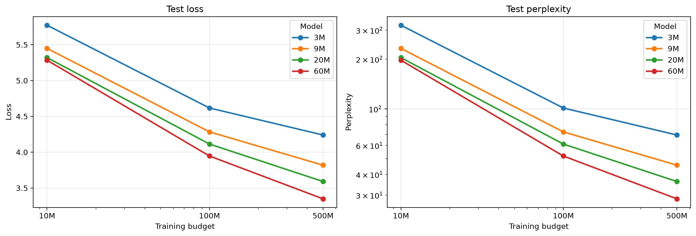

# Ukrainian GPT-2 Scaling Study

This is my personal project with small GPT-2 models. I trained them from scratch on Ukrainian text from the web. I wanted to see how the results change when I use a bigger model or train it for longer.

I used Jupyter notebooks (`.ipynb`) to prepare the data, train the models, and compare the results. I did not run the experiments through separate training or data preparation scripts.

I started with the 3M model and later added **9M, 20M, and 60M** models. For each size, I have saved models at **10M, 100M, and 500M training tokens**. These saved versions are called checkpoints. There are 12 combinations in total.

The model name tells us how many parameters it has. The training budget tells us how many input tokens it processes during training. For example, **20M / 500M** means a model with about 20 million parameters and a budget of 500 million tokens.

## What I built

I used `GPT2LMHeadModel` from Hugging Face. All four models use the same tokenizer, vocabulary size, and context length.

| Model | Actual parameters | Layers | Attention heads | Hidden size | MLP size |
| --- | ---: | ---: | ---: | ---: | ---: |
| 3M | 3,270,656 | 6 | 4 | 128 | 512 |
| 9M | 9,087,008 | 9 | 7 | 224 | 896 |
| 20M | 19,998,080 | 12 | 10 | 320 | 1280 |
| 60M | 58,762,240 | 16 | 16 | 512 | 2048 |

All models have 16,000 tokens in their vocabulary and can read 256 tokens at a time.

## Data and tokenizer

I used the Ukrainian part (`ukr_Cyrl`) of `HuggingFaceFW/fineweb-2`. The code reads the dataset in streaming mode, so it does not need to download the whole dataset first.

First, I trained a Byte-Level BPE tokenizer on the first 100,000 documents that contain text. The data preparation notebook then skips the first 100,000 dataset rows and prepares:

- 500M tokens for training;
- 5M tokens for validation;
- 5M tokens for testing.

I saved the tokenizer in `tokenizer/tokenizer.json` and used it for all models. The tokenizer training and data preparation code are in `data_prep.ipynb`. Running all its cells again trains and saves the tokenizer again. To keep the same tokenizer, I need to reuse the saved file and skip the cells that train and save a new one.

## Training

Each training step uses 32 sequences of 256 tokens: **8,192 input tokens per step**. The code picks random parts of the training data, so it can use the same text more than once. A budget of 500M tokens does not mean that the model has seen every token in the dataset exactly once.

In `model_prep.ipynb`, `TRAIN_TOKENS` controls two things: how much of the training file is available and how many training steps the model takes. For example, a 10M run samples from the first 10M tokens in the file. So a larger budget means both more available text and more training steps.

The settings in the training notebook are:

| Setting | Value |
| --- | --- |
| Optimizer | AdamW  |
| Maximum learning rate | `1e-3` |
| Minimum learning rate | `1e-4` |
| Warmup | 200 steps |
| Schedule after warmup | Cosine decay |
| Weight decay | `0.1` on parameters with two or more dimensions |
| Gradient clipping | `1.0` |
| Validation | Every 250 steps, using 50 sampled batches |

In this notebook, each model size and budget is a separate training run. I choose `MODEL_SIZE` and `TRAIN_TOKENS`, create a new model, and start training. A 500M run does not automatically save separate 10M and 100M checkpoints.

The notebook saves the model whenever validation loss improves. Each new best result replaces the previous checkpoint for that run. The filename shows the chosen budget, but the saved model may come from an earlier step. This applies to all three budgets, not only 500M. The learning-rate schedule also depends on the full budget of each run.

The code passes `labels=x` when it calculates loss. GPT-2 shifts the labels inside the model to predict the next token. The current notebook does not use BF16, `torch.compile`, or an explicit fused AdamW setting. It keeps the data in memory-mapped files and copies each batch to the GPU. During this project, I used my laptop with an RTX 4060 and a server with an H200.

## Test results

I tested all 12 checkpoints with the same code and test file: `data/test/test_5M.bin`. The code reads separate blocks of 256 tokens in batches of 32. It uses only full blocks and skips the small part left at the end.

These results come from `results/model_comparison_results.csv`. **Lower is better** for both loss and perplexity. Perplexity is calculated as `exp(test_loss)`. It does not show the percentage of wrong predictions.

| Model | Training budget | Test loss ↓ | Perplexity ↓ |
| --- | ---: | ---: | ---: |
| 3M | 10M | 5.7722 | 321.24 |
| 3M | 100M | 4.6172 | 101.21 |
| 3M | 500M | 4.2404 | 69.43 |
| 9M | 10M | 5.4489 | 232.51 |
| 9M | 100M | 4.2840 | 72.53 |
| 9M | 500M | 3.8193 | 45.57 |
| 20M | 10M | 5.3206 | 204.51 |
| 20M | 100M | 4.1141 | 61.20 |
| 20M | 500M | 3.5914 | 36.29 |
| 60M | 10M | **5.2838** | **197.12** |
| 60M | 100M | **3.9471** | **51.79** |
| 60M | 500M | **3.3497** | **28.49** |

### Loss and perplexity



Each line shows one model size. The horizontal axis shows the training budget. It uses a log scale, and so does the perplexity axis. Each line connects three test results: at 10M, 100M, and 500M tokens. It does not show every training step.

### What I found

- Every model got better test scores with more training.
- At each budget, bigger models had lower loss and perplexity.
- The best result is **60M / 500M: loss 3.3497 and perplexity 28.49**.
- At 500M tokens, the 60M model has about **59% lower perplexity** than the 3M model: 28.49 compared with 69.43.
- At 10M tokens, the 60M model is only a little better than 20M: its loss is about **0.7% lower**. The gap grows to **4.1% at 100M** and **6.7% at 500M**.

In my results, both a bigger model and more training helped. But I only tested four sizes and three budgets, and I did not repeat the training runs. I would need more experiments to say if this holds more generally.

## How the generated text changed

I gave each checkpoint the same five prompts:

- `Столиця України`
- `Президент`
- `Одного вечора`
- `Найбільша річка в Україні`
- `Ukraine is`

For each prompt, the model can generate up to 100 new tokens. I used temperature `0.8`, top-k `50`, and top-p `0.95`. The code samples tokens without a fixed seed, so running it again can give different text.

The CSV with generated text has **85 rows**. Some models have more than one saved answer to the same prompt. For each model, budget, and prompt, I used the **last saved row**. I shortened the examples below and replaced line breaks with spaces. The words and grammar are unchanged. I did not generate new examples for this README.

### Same prompt, more training

Prompt: **`Одного вечора`**

These examples show how the text changed with more training. One example can still look worse, even if the model has a better test score.

| Model | Training budget | Generated text (shortened) |
| --- | ---: | --- |
| 3M | 10M | Одного вечора, що я не не лише надику. Як тільки в його за, які не ще не робити. Необхідно, а також, і не в першу чергу, приходити і я. І якщо він не маєте. По-сері. Нажки і це є… |
| 3M | 100M | Одного вечора, коли я хотів говорити, що не був такий. Він також був, що, як він був був на висоті, він був в нашій землі. За два дні, коли він мав на увазі що вона була. Після… |
| 3M | 500M | Одного вечора, з-за в'язненого. Поки що вони не можуть віджитися. Але ж там в нас не потрібно. І вже з кожним цим не можна їх робити. Але це не означає, що за останні роки ви… |
| 9M | 10M | Одного вечора. Про це буде розсили У місті застуріла Заком на вулиці Мейх Шаны, Вы выми, Ми вно Заты оть из отым и кымся ви, Вы Гыть, ЛЕ. Охли: Вы, что оте -го Кы были выли и… |
| 9M | 100M | Одного вечора буде не так. І саме у нас забажання, це вже не так, як я до наших дій, але з часом. А в цьому – все таки! На жаль, якщо у нас немає жодних ризиків, ми не будемо. Я… |
| 9M | 500M | Одного вечора я не бачила. А ще в будинку, у будинку, я був на дорозі. Але я не бачив – не знаю, хто не бачив. – Ні, коли я знаю, я його знаю. – Я знаю, чи немає, – відповів, –… |
| 20M | 10M | Одного вечора. Як виїхати на неї, коли він може не розкривати. Збірки, забираючи всі інші. Окрекальнику не лише так само, як і відчай. Використання. У випадку не можна додати на… |
| 20M | 100M | Одного вечора на Мальтині. Зранку був приїзд у хоровому кишеню в Мальті і я відчула з неї бажання, а в мене було дуже багато часу, але я вирішила вболіватись у команді і… |
| 20M | 500M | Одного вечора ми з однорічним сусідом почули про те, що нас оточує і як один із нас, який живе, не розказуючи, що не міг сказати, що хоче, щоб він не впорався із собою. Послухавши… |
| 60M | 10M | Одного вечора і, у тому числі у різних частинах, у якому в Україні, то й за рахунок такої діяльності, не допускаючись в його думку, а в зв'язку з боку «Повідомати» і не в собі,… |
| 60M | 100M | Одного вечора в кімнаті у сусідніх. - Улюблені на вулиці — це дуже корисно, адже кожен рік може бути удостоєний на мить. - Зовсім нестерпно, адже ми пропонуємо відпочинок в… |
| 60M | 500M | Одного вечора в готелі «Японія» була проведена екскурсія по ресторанам. Після екскурсії гості мають можливість насолоджуватися напоями. Відпочинок в готелі «Японія» - не менш… |

With less training, the models often make broken words, mix parts of sentences, and repeat phrases. With more training, the sentences become easier to read. Still, even the bigger models repeat themselves and move away from the topic.

For example, 9M / 500M keeps repeating “Я знаю”. The 60M / 500M model writes several sentences about a hotel. The sentences fit together better, but I got something like a hotel ad from the prompt “Одного вечора”.

### The English prompt

I did not add a separate English dataset. Some pages in the Ukrainian dataset may contain text in other languages. I added this prompt just to see what the models would write in English. It is not enough to properly test their English.

Prompt: **`Ukraine is`**, at the **500M budget**.

| Model | Generated text (shortened) |
| --- | --- |
| 3M | Ukraine is soland partnical: Sciteds of a world, prival of a comments of a campair, prival of the plize in the prival of the caiscal some a can a cois a sevel of can… |
| 9M | Ukraine is conversed on the state of the human inteligiated in Ukraine. Medical motivity to the participation of methods in the cover of reducing based the capital… |
| 20M | Ukraine is a relativate a number of fast. There were a business about out about unny was event got at the type. - enbild. - Hair has a traft of enable, is already? - -… |
| 60M | Ukraine is for understanding the context of the establishment of the formation of information of the information reviewing in promotive prises, which are should like a… |

Some parts look like English sentences, but there are still broken words and repeated phrases. The meaning is often unclear.

## Things to keep in mind

- I have one checkpoint for each model size and budget. Generating text several times is not the same as training a model several times.
- A checkpoint's name shows the training budget. The notebook saves the model with the best validation loss, so the actual saved step may be earlier than the last step.
- A larger budget also makes a larger part of the training file available. These results do not separate the effect of more training steps from the effect of more available data.
- The data code does not select a fixed version of FineWeb-2. If the dataset changes, preparing it again may give different data.
- The data notebook skips dataset rows, but its document counters only count text that is not empty. If there are empty rows, the split boundaries may be wrong. I have not checked the saved splits for overlap.
- The code does not always set NumPy and PyTorch seeds. Text generation also has no fixed seed. This means that results can change between runs.
- Loss and perplexity depend on the tokenizer, test data, context length, and test method. I use these scores to compare models within this project.
- The text examples help me see what the models can write. They do not give a full score for writing quality, correct facts, or following instructions.
- `requirements.txt` does not set exact package versions, so a new installation may use different versions.

## Running the project

Install the required packages in your Python environment:

```bash
python -m pip install -r requirements.txt
```

Open Jupyter from the project folder:

```bash
jupyter notebook
```

If you are starting from zero, open `data_prep.ipynb` and run its cells in order. This trains the tokenizer and creates the training, validation, and test files. If you already have these files and the saved tokenizer, you can skip data preparation.

Keep the binary data files with the tokenizer that created them. To use the same test data on another computer, copy these files and the saved tokenizer there.

Open `model_prep.ipynb` and choose the model size and budget in the settings cell:

```python
MODEL_SIZE = "60M"  # "3M", "9M", "20M", or "60M"
TRAIN_TOKENS = 500_000_000
```

Make sure the `models/` folder exists. Run the cells in order to load the data, create the model, and train it. To train another size or budget, change the settings and restart the kernel before running the cells again. This creates a new model and optimizer for each run. To get all 12 combinations with this notebook, run each of the four sizes with each of the three budgets.

Run `model_compare.ipynb` to test the saved models and generate text. It looks for the 12 checkpoint files in `models/` and skips any that are missing. It saves the scores and text in separate CSV files.

`data_research.ipynb` currently only loads these CSV files and shows the first rows of the metric table. It does not contain the code for the graph shown above. The graph is saved separately as `results/model_comparison.png`. You can use the saved CSV files to make graphs without testing the models again.

Both model notebooks import `create_model` from `create_model.py`. This helper contains the model settings and creates the model. I ran the experiments from notebooks, but they still need this helper to work. It is currently missing from the working folder, so it needs to be restored before running the model notebooks.

## Files

| File | Purpose |
| --- | --- |
| `create_model.py` | Helper imported by the model notebooks; currently missing from the working folder |
| `data_prep.ipynb` | Code to train the tokenizer and prepare the data |
| `model_prep.ipynb` | Training notebook |
| `model_compare.ipynb` | Code to test models and generate text |
| `data_research.ipynb` | Code to load the CSV files and show the first metric rows |
| `results/model_comparison_results.csv` | The 12 metric rows used in this README |
| `results/model_comparison_prompt_results.csv` | The generated text used in the examples |
| `results/model_comparison.png` | The graph for comparing models |

Git ignores `data/`, `models/`, `tokenizer/`, and `results/`. You need to copy these folders separately or create their files again. The graph is also inside the ignored `results/` folder. For it to appear on GitHub, the image needs to be added to Git or moved to a tracked folder, with the image link updated.

## Share your results

If you try this experiment, I would like to see your results! Open an [issue](https://github.com/wroole/Ukrainian-GPT-2-Scaling-Study/issues) and share your model size, training budget, test scores, and a few text examples. Ideas and questions are welcome too.
